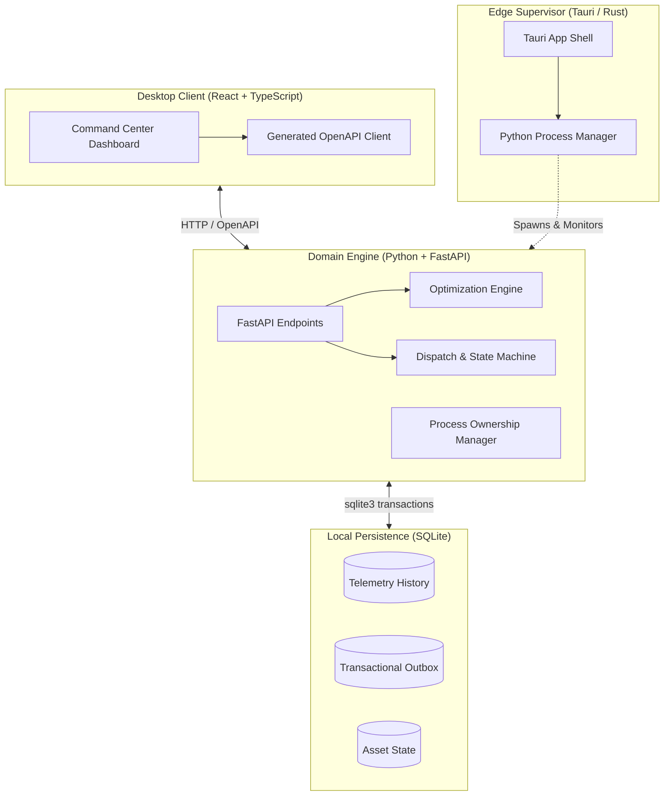
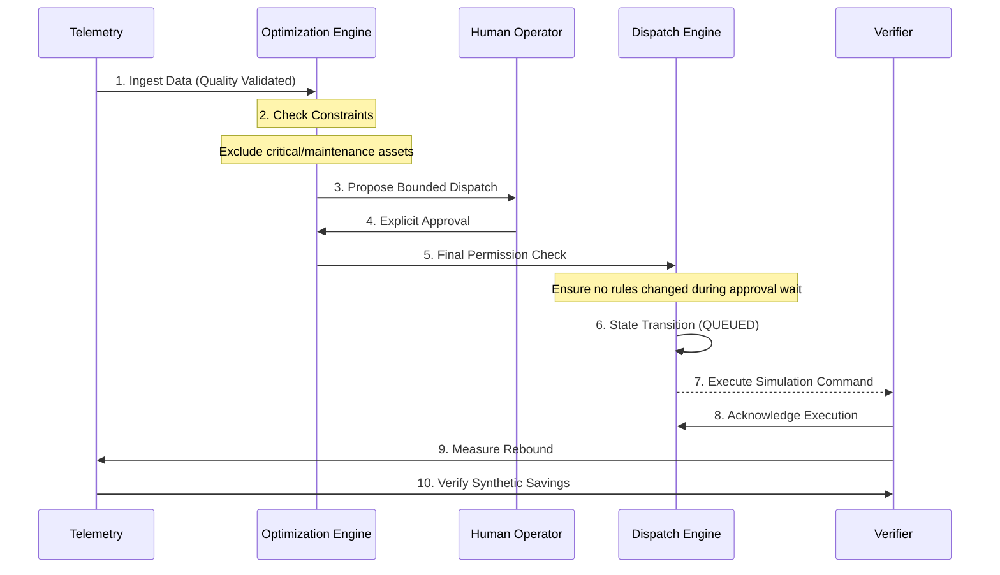

# GridForge AI: System Design & Architecture

This document provides a comprehensive overview of the GridForge AI desktop prototype architecture, detailing how the frontend, supervisor, domain logic, and persistence layers interact securely to process simulated industrial energy decisions.

## 1. High-Level Architecture

GridForge AI is built as a **Modular Monolith** designed for edge and offline-capable industrial environments. The architecture separates presentation, process supervision, domain logic, and persistence while keeping them packaged locally for the operator.

- **Frontend (UI/UX):** React 19 and TypeScript, bundled with Vite.
- **Supervisor (App Shell):** Tauri v2 (Rust), responsible for window management, filesystem access, and process supervision.
- **Domain Engine (Backend):** Python 3.12 and FastAPI, running as an embedded headless service managing state and business rules.
- **Persistence:** SQLite for edge-local storage, utilizing the Transactional Outbox pattern for eventual cloud synchronization (PostgreSQL).

### 1.1 Component Diagram

## 2. The Decision Chain (Core Workflow)

GridForge AI strictly decouples mathematical forecasting from hard operational rules. The system enforces a non-negotiable chain of events before any simulated machine adjustment is queued.

### 2.1 Decision Chain Diagram

## 3. Detailed Component Breakdown

### 3.1 Domain Services (Python)

The domain logic is isolated from the UI to ensure rules cannot be bypassed.

- **Optimization Engine (`engine.py`):** Calculates proposals. Uses pure functional gates (`gate("NONCRITICAL")`, `gate("MAINTENANCE")`) to strictly filter out equipment that is unsafe to touch, regardless of the mathematical optimum.
- **Dispatch Service (`service.py`):** A strict state machine. Validates `decide` actions (approvals) by re-running constraint checks to ensure the factory state hasn't shifted dangerously between the time a proposal was made and the time a human approved it.

### 3.2 Process Ownership (`ownership.py`)

Because the local edge database (`.local/edge.db`) stores critical transactional outbox events and dispatch states, GridForge implements an exclusive lock mechanism.

- Only one Python process can acquire the SQLite database lock at a time.
- If a duplicate process attempts to start, it is rejected immediately, preventing corruption or duplicate simulator dispatches.

### 3.3 The Transactional Outbox

All critical domain actions (telemetry ingestion, dispatch transitions, approvals) are written to a local SQLite Outbox table in the same transaction as the state change.

- **Why:** Ensures that if network connectivity drops, the operator can continue running the factory safely using the local application.
- **Sync:** When connectivity is restored, the outbox events are synced to the cloud (PostgreSQL) idempotently.

## 4. Key Design Principles

1.  **Never act on unknown risk:** If telemetry data quality is bad or stale, the system marks risk as `UNKNOWN` rather than guessing, halting automated proposals.
2.  **Separate simulated dispatch from verification:** Receiving a "success" acknowledgement from a simulated machine is not enough. The system waits to measure actual demand rebound via telemetry to verify synthetic savings.
3.  **Human is authoritative:** The AI and forecasts _advise_. Hard constraints and human authorization _decide_.
